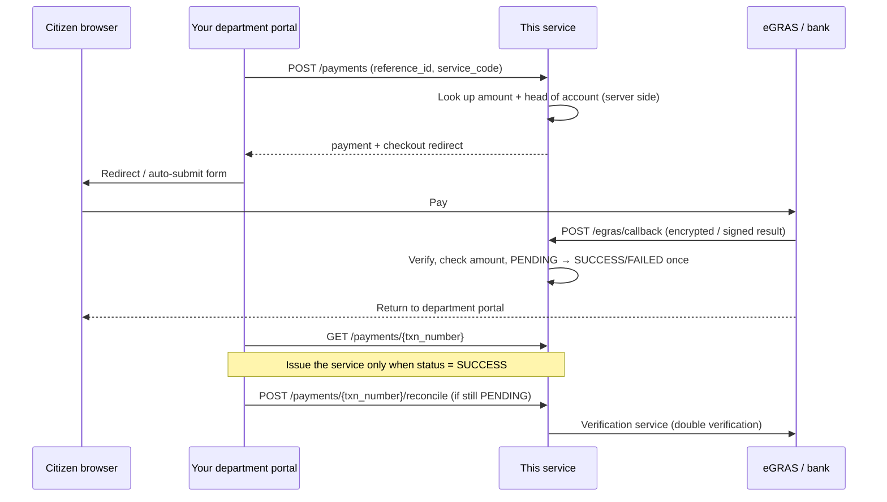

# eGRAS Payment Gateway Integration (Python / FastAPI)

**A working starter for integrating eGRAS, the government receipt and online challan payment system, into
your department's web portal.** It has a built-in mock eGRAS, so you can run and click through a complete
payment on your laptop in about five minutes, without any government credentials. To go live, you fill in
one file from your state's official eGRAS integration document.

Maintained by **[Visual App Foundry](https://vaf.ai)**.

> **Need help going live?** Visual App Foundry handles eGRAS integrations end to end: onboarding paperwork,
> encryption, UAT and production support. **Contact us at [vaf.ai](https://vaf.ai).**

**Contents:** [What is eGRAS](#what-is-egras) · [Who this is for](#who-this-is-for) · [How it works](#how-the-payment-flow-works) ·
[Setup](#setup-step-by-step) · [Try a payment](#try-a-payment) · [Go live](#going-live-with-real-egras) ·
[Your database](#bring-your-own-database) · [Troubleshooting](#troubleshooting) · [FAQ](#faq)

---

## What is eGRAS?

**eGRAS (Electronic Government Receipt Accounting System)** is the online system that several Indian state
finance / treasury departments use to receive government money (fees, taxes, fines, deposits) straight
into the state treasury through an online challan.

A department's portal (for example, a certificate, licence or registration portal) never handles the money itself:

1. It creates a payment request (an e-challan) for a fixed amount, booked against the correct budget
   **head of account**.
2. It sends the citizen's browser to eGRAS, where the citizen pays by net banking, card or UPI through a bank.
3. eGRAS sends the result back, with a reference such as a **GRN** (the name varies by state).
4. The portal double-checks the result with eGRAS's verification service before issuing the service.

Each state runs its own eGRAS. Field names, encryption, URLs and onboarding steps differ, and they come in
an **official integration document** that the treasury gives your department along with test (UAT)
credentials. This project handles everything around that document, so the state-specific code is one small file.

## Who this is for

- Developers asked to "integrate eGRAS" for the first time
- Software vendors building department portals that collect government fees
- Teams who want a safe reference design for online challan payments, callbacks and double verification

## How the payment flow works



### Safety rules already built in

| Risk                           | How it is handled                                                                                                      |
| ------------------------------ | ---------------------------------------------------------------------------------------------------------------------- |
| Citizen changes the amount     | The client sends only `service_code`. The server decides amount and head of account ([fees.py](app/services/fees.py)). |
| Double payment on retry        | `reference_id` is unique per user, so re-sending returns the same payment.                                             |
| Fake "payment successful" page | Status changes only through a verified callback, never a browser redirect.                                             |
| Forged or tampered callback    | The adapter verifies the payload, and the service rejects any amount mismatch.                                         |
| Duplicate or racing callbacks  | One atomic `PENDING → final` change. Repeats are accepted, contradictions return 409.                                  |
| Callback never arrives         | `POST /payments/{txn}/reconcile` asks eGRAS directly.                                                                  |
| Going live half-finished       | eGRAS mode won't start until the adapter is complete. Mock mode can't run in production.                               |

---

## Setup (step by step)

### 1. Prerequisites

- **Python 3.11 or newer.** Check with `python --version` (on macOS/Linux, `python3 --version`).
- **Git**
- No database, no government credentials and no internet access to eGRAS are needed for the demo.

### 2. Download the code

```bash
git clone https://github.com/YOUR-ORG/egras-payment-gateway-integration.git
cd egras-payment-gateway-integration
```

### 3. Create a virtual environment and install

**Windows (PowerShell)**

```powershell
python -m venv .venv
.venv\Scripts\Activate.ps1
pip install -r requirements-dev.txt
Copy-Item .env.example .env
```

**macOS / Linux**

```bash
python3 -m venv .venv
source .venv/bin/activate
pip install -r requirements-dev.txt
cp .env.example .env
```

### 4. Set your secrets in `.env`

Open `.env` in any editor and replace the two `change-me-...` values (`API_KEY` and `MOCK_CALLBACK_SECRET`)
with **two different** random strings. To generate one:

```bash
python -c "import secrets; print(secrets.token_urlsafe(48))"
```

Run it twice, once for each value. Leave `GATEWAY_MODE=mock` for now.

### 5. Start the server

```bash
uvicorn app.main:app --reload
```

You should see `Uvicorn running on http://127.0.0.1:8000`. Open:

- **http://localhost:8000/docs**: interactive API documentation (Swagger)
- **http://localhost:8000/health**: should show `{"status":"ok"}`

### 6. Run the tests (optional)

```bash
python -m pytest -q
```

---

## Try a payment

### Option A: in the browser (easiest)

1. Open **http://localhost:8000/docs**.
2. Open **POST /payments** and click **Try it out**.
3. Fill in the headers:
   - `x-api-key`: the `API_KEY` from your `.env`
   - `x-user-id`: any UUID, for example `11111111-1111-4111-8111-111111111111`
4. Use this request body and click **Execute**:
   ```json
   {
     "reference_id": "APP-2026-000123",
     "service_code": "DEMO_CERTIFICATE",
     "payer_name": "Demo Citizen"
   }
   ```
5. Copy `checkout.url` from the response and open it in a new tab. This is the mock eGRAS payment page.
6. Click **Pay**. The page shows `Payment SUCCESS` and a mock GRN.
7. Back in `/docs`, run **GET /payments/{txn_number}** with the `txn_number` from step 4. The status is now `SUCCESS`.

### Option B: from the command line

**Windows (PowerShell)**

```powershell
$h = @{ "X-API-Key" = "<API_KEY from .env>"; "X-User-ID" = "11111111-1111-4111-8111-111111111111" }
$body = '{"reference_id":"APP-2026-000123","service_code":"DEMO_CERTIFICATE","payer_name":"Demo Citizen"}'
$r = Invoke-RestMethod -Method Post -Uri http://localhost:8000/payments -Headers $h -ContentType "application/json" -Body $body
$r.checkout.url          # open this in a browser and click Pay
Invoke-RestMethod -Uri "http://localhost:8000/payments/$($r.payment.txn_number)" -Headers $h
```

**macOS / Linux**

```bash
KEY="<API_KEY from .env>"; USERID=11111111-1111-4111-8111-111111111111
curl -s -X POST http://localhost:8000/payments \
  -H "X-API-Key: $KEY" -H "X-User-ID: $USERID" -H "Content-Type: application/json" \
  -d '{"reference_id":"APP-2026-000123","service_code":"DEMO_CERTIFICATE","payer_name":"Demo Citizen"}'
# open checkout.url in a browser and click Pay, then:
curl -s http://localhost:8000/payments/<txn_number> -H "X-API-Key: $KEY" -H "X-User-ID: $USERID"
```

### API reference

| Method     | Path                               | Called by                | Purpose                                              |
| ---------- | ---------------------------------- | ------------------------ | ---------------------------------------------------- |
| `GET`      | `/payments/fees`                   | Department backend       | Payable services and their amounts                   |
| `POST`     | `/payments`                        | Department backend       | Create a payment and get the checkout redirect       |
| `GET`      | `/payments`                        | Department backend       | User's payments, filter by `status` / `reference_id` |
| `GET`      | `/payments/{txn_number}`           | Department backend       | Authoritative payment status                         |
| `POST`     | `/payments/{txn_number}/reconcile` | Department backend       | Re-verify a PENDING payment with eGRAS               |
| `POST`     | `/egras/callback`                  | eGRAS                    | Payment result (JSON or form post)                   |
| `GET/POST` | `/mock-egras/checkout/...`         | Browser (mock mode only) | Pretend payment page                                 |
| `GET`      | `/health`                          | Monitoring               | Health check                                         |

Department endpoints need `X-API-Key`, plus `X-User-ID` for the citizen. **`X-User-ID` is for the demo only.**
Replace it with your portal's real login (JWT/OIDC) before production.

---

## Going live with real eGRAS

The full walkthrough is in **[docs/EGRAS_INTEGRATION.md](docs/EGRAS_INTEGRATION.md)**. In short:

1. **Get onboarded.** Your department applies to the state treasury / eGRAS team and receives the
   integration document, merchant/department code, keys and UAT URLs.
2. **Add your fees.** Put your real services, amounts and heads of account in [app/services/fees.py](app/services/fees.py).
3. **Complete the adapter.** Fill in the four TODOs in [app/gateways/egras.py](app/gateways/egras.py)
   (build request, encrypt, verify callback, double verification) and set `implemented = True`.
4. **Connect your database.** See the next section.
5. **Configure and test.** Set `GATEWAY_MODE=egras` and the `EGRAS_*` values in `.env`, pass the UAT
   checklist, then switch to production URLs.

## Bring your own database

This repository intentionally contains **no database code**, so it stays focused on eGRAS. Payments are
kept in an in-memory demo store, which the app refuses to use in production. To go live, implement the
small `PaymentStore` interface in [app/services/payment_store.py](app/services/payment_store.py) on the
database you already use (the fields are in [app/models/payment.py](app/models/payment.py)), and return it
from `get_store()` in [app/core/dependencies.py](app/core/dependencies.py).

Whatever database you use, keep these two rules:

1. **One payment per application.** Use a unique constraint on `(user_id, reference_id)`.
2. **Status changes exactly once.** Use one conditional update and check how many rows changed:
   `UPDATE payments SET status = ?, gateway_reference = ? WHERE txn_number = ? AND status = 'PENDING'`

## Project layout

```text
app/
├── main.py                     # start-up and safety checks
├── api/payments.py             # department-facing endpoints
├── api/callbacks.py            # endpoint eGRAS posts results to
├── api/mock_egras.py           # pretend eGRAS payment page (mock mode only)
├── gateways/base.py            # interface every gateway implements
├── gateways/mock.py            # working mock gateway
├── gateways/egras.py           # ← complete this for real eGRAS
├── services/payment_service.py # rules: retries, amount check, safe status changes
├── services/fees.py            # ← your fees and heads of account
├── services/payment_store.py   # ← plug in your database
├── models/ schemas/ core/      # payment record, API shapes, config, auth
docs/EGRAS_INTEGRATION.md       # step-by-step go-live guide
tests/                          # end-to-end tests with the mock gateway
```

---

## Troubleshooting

| Problem                                                              | Fix                                                                                                |
| -------------------------------------------------------------------- | -------------------------------------------------------------------------------------------------- |
| `Activate.ps1 cannot be loaded because running scripts is disabled`  | Run `Set-ExecutionPolicy -Scope Process -ExecutionPolicy Bypass`, then activate again.             |
| `'python' is not recognized` / `command not found`                   | Install Python 3.11+ and tick "Add Python to PATH" (Windows), or use `python3` (macOS/Linux).      |
| Start-up error `API_KEY must be set and at least 32 characters long` | `.env` is missing or the value is too short. Repeat setup step 4.                                  |
| Start-up error `API_KEY and MOCK_CALLBACK_SECRET must be different`  | Generate two separate values.                                                                      |
| Start-up error `app/gateways/egras.py is not completed yet`          | You set `GATEWAY_MODE=egras` before finishing the adapter. Use `mock` until then.                  |
| `401 Invalid API key`                                                | The `X-API-Key` header doesn't match `API_KEY` in `.env`. Restart the server after editing `.env`. |
| `401 A valid X-User-ID (UUID) header is required`                    | Send a UUID such as `11111111-1111-4111-8111-111111111111`.                                        |
| `409 reference_id already used for a different service`              | Each `reference_id` belongs to one service. Use a new reference.                                   |
| Port 8000 already in use                                             | `uvicorn app.main:app --reload --port 8001`                                                        |
| Payments disappear after restart                                     | Expected in the demo (in-memory store). Connect your database to keep them.                        |

## FAQ

**Is this an official eGRAS SDK?** No. It is an independent open-source starter. The eGRAS protocol details come
from your state's official integration document.

**Which states does it support?** The design works for any state's eGRAS. Only [egras.py](app/gateways/egras.py)
is state-specific.

**Can I use another payment gateway?** Yes. Implement the same three methods from
[gateways/base.py](app/gateways/base.py) for any gateway.

**Where do I get eGRAS credentials?** From your state's finance department / treasury (eGRAS team), through
your department. Developers can't self-register.

**Can you do the integration for us?** Yes. Contact **[Visual App Foundry](https://vaf.ai)**.

## Related project

- **ration-card-verification-api**: ration card verification with OTP, citizen registration and JWT login,
  also from Visual App Foundry.

## Disclaimer and licence

Independent, vendor-neutral starter. It is **not** an official eGRAS product and is not endorsed by any
government. It contains no government credentials, internal documents or personal data. Real integration
needs authorisation from your state's treasury and follows its official specification.

MIT licensed, see [LICENSE](LICENSE). © Visual App Foundry · **[vaf.ai](https://vaf.ai)**

# egras-payment-gateway-integration

eGRAS payment gateway integration in Python (FastAPI). Online challan payment, secure callback verification and double verification, with a working mock so you can run it in 5 minutes. No credentials needed.
